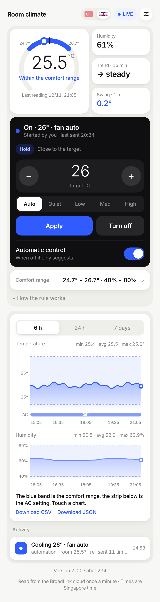

# klima-bulut

Reads a BroadLink RM4 Mini + HTS2 temperature/humidity sensor through the BroadLink app cloud, stores it on Cloudflare (Worker + D1), serves a small bilingual (Turkish/English) dashboard, and can optionally drive an IR air conditioner to keep the room inside a comfort band. No always-on computer needed.

The dashboard with dummy data (Turkish and English, light and dark): dial with the comfort band, trend and last-hour swing, AC controls, comfort range, history with a strip showing the AC setting, and an activity log. Card order and theme are set from the settings button.

- `cloud/` - Worker, dashboard (Turkish/English), D1 schema, IR code seed
- `lib/broadlink-app-cloud.js` - client for the BroadLink app cloud (sensor read, IR send)
- Tests: `npm test`

## Read this first

- **Unofficial.** BroadLink offers no public API for individuals. This project replays a request captured from the BroadLink phone app on your own account. It can break at any time, and the captured session expires at an unknown time.
- **Your session is a credential.** The captured request carries your login session. It lives only in a Cloudflare secret (`BROADLINK_SESSION`). Never commit, paste or share it.
- **IR is one-way.** The AC's real state is unknown; the Worker only knows the last command it sent.
- Use at your own risk, and check BroadLink's terms for your account.

Setup: [cloud/README.md](cloud/README.md). What was learned and what failed: [docs/FINDINGS.md](docs/FINDINGS.md). License: MIT.

## Credits

The `cool_*` IR codes come from [SmartIR](https://github.com/smartHomeHub/SmartIR) (device 1287). Replace them with codes for your own AC (see `cloud/seed/ir_codes.sql`).
